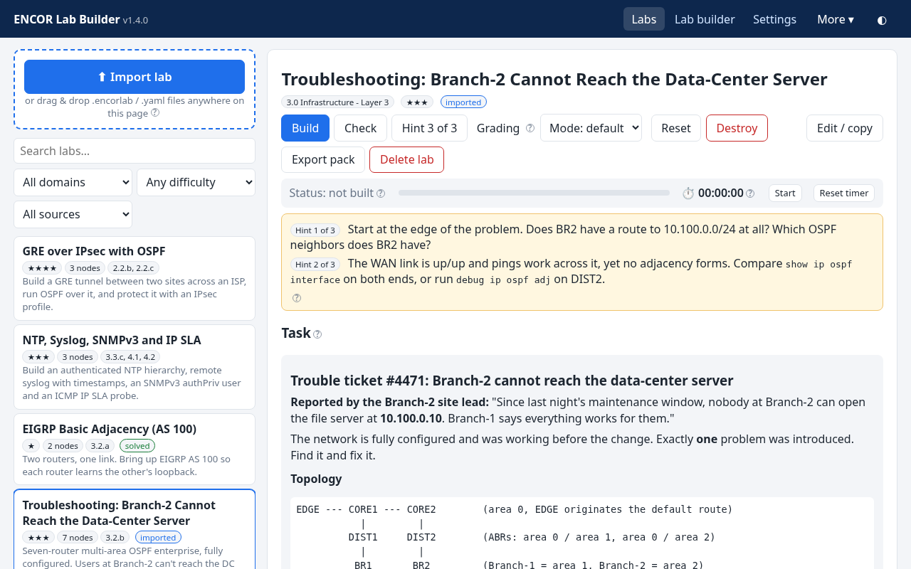
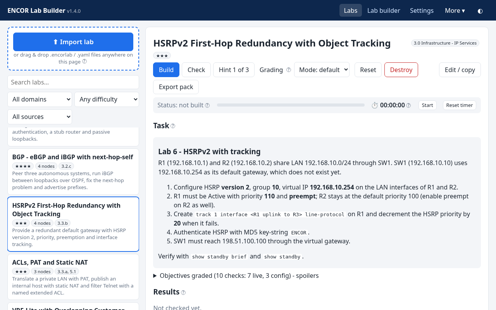
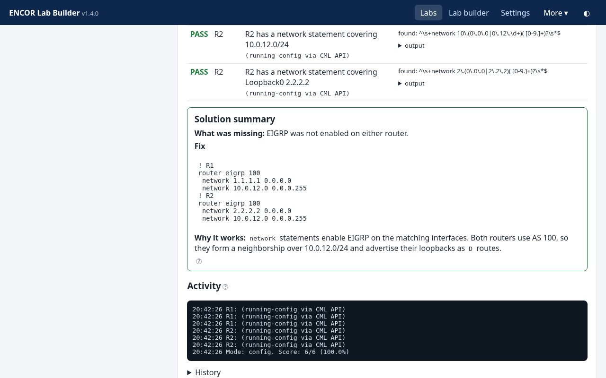
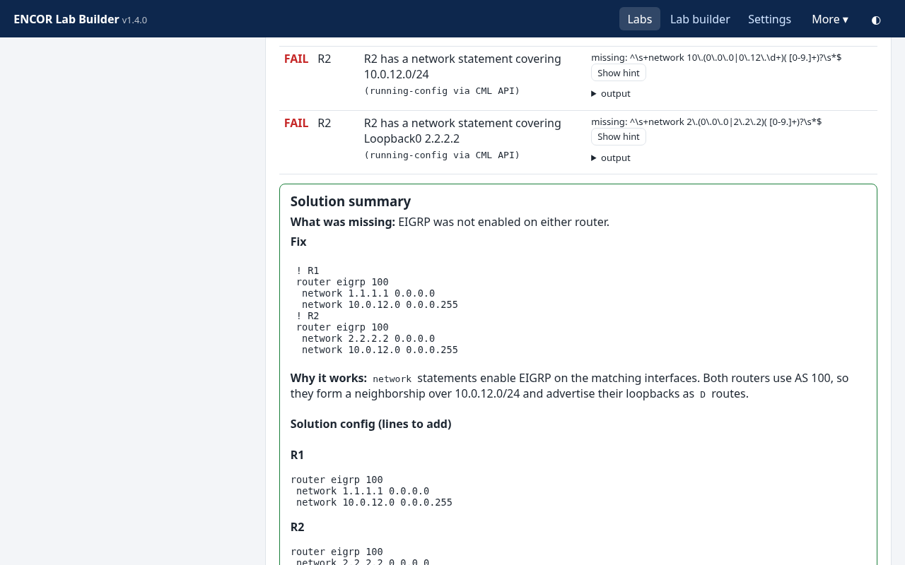
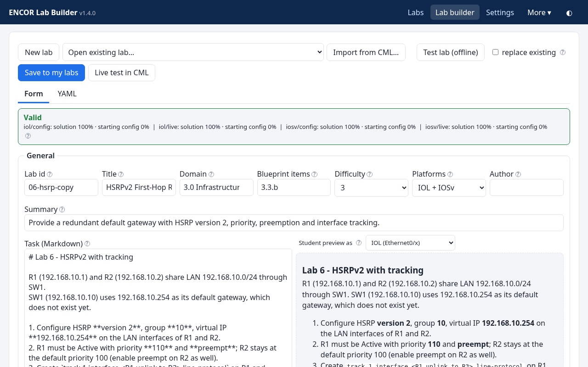
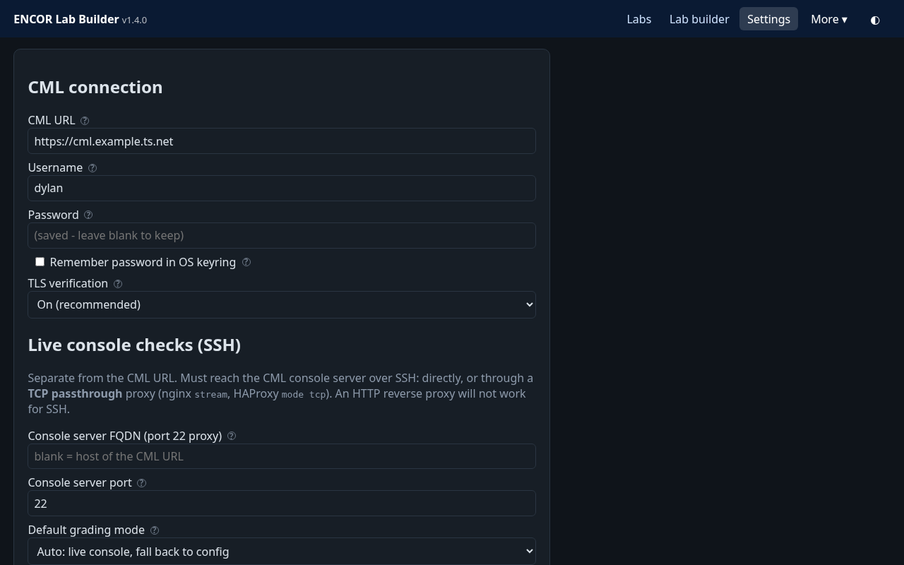
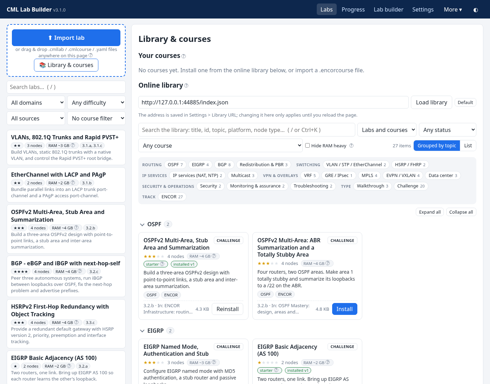

# CML Lab Builder

**Build practice labs in Cisco Modeling Labs (CML) 2.9 and auto-grade your solutions: CCNP ENCOR (350-401) and other tracks.**

> **Formerly ENCOR Lab Builder.** Up to 2.1.0 this app was called **ENCOR Lab Builder** (repo `Specops13/encore-lab-app`,
> program `ENCORLab.exe`, package `encorlab`). Not every lab is for ENCOR any more, so since 3.0.0 everything is named
> **CML Lab Builder**: the program (`CMLLabBuilder.exe`, `cml-lab-builder`, `cmllab`), the downloads, the Debian
> package, the data folder and the labs it creates in CML (`CML-<lab>`). 3.0.0 is a **full download**: your old app
> tells you so and links the right file. Your data moves by itself. See
> [Upgrading from ENCOR Lab Builder](#upgrading-from-encor-lab-builder-17--21).

[](https://github.com/Specops13/cml-lab-builder/releases/latest)


[](LICENSE)

Pick a lab and click **Build**: the topology is imported into your CML server, booted and pre-configured.
Solve the task on the device consoles, then click **Check**. The app grades you with read-only `show`/`ping`
commands (live mode) or by reading the running configs over the CML API (config mode). It tells you what passed,
what failed and why. Progressive hints and a solution summary help you learn instead of just getting a score.
It runs as a local web UI on `127.0.0.1` (plus an equivalent CLI). Device checks go through the **CML console
server**, so your PC only needs to reach the CML controller, not the lab devices.



## Contents
- [Features](#features)
- [Screenshots](#screenshots)
- [Quick start (ready-to-run download)](#quick-start-ready-to-run-download)
- [Install on Debian / Ubuntu (.deb)](#install-on-debian--ubuntu-deb)
- [Upgrading from ENCOR Lab Builder (1.7 - 2.1)](#upgrading-from-encor-lab-builder-17--21)
- [Where your data lives](#where-your-data-lives)
- [Updating (small patches instead of a full download)](#updating-small-patches-instead-of-a-full-download)
- [Uninstalling](#uninstalling)
- [Running from source](#running-from-source)
- [CML requirements](#cml-requirements)
- [Using it](#using-it)
- [Grading modes](#grading-modes)
- [Creating and importing labs](#creating-and-importing-labs)
- [Configuration](#configuration)
- [Troubleshooting and diagnostics](#troubleshooting-and-diagnostics)
- [Building the executables](#building-the-executables)
- [Project layout](#project-layout)
- [Development / tests](#development--tests)
- [Version and changelog](#version-and-changelog)
- [License](#license)

## Features
- **Small download, labs from the library (new in 2.0.0):** the app no longer ships with labs. On the first start the
  Labs page offers **Install recommended starter set** (one click), **Browse library** and **Import a lab file** (`.cmllab`, or `.encorlab` from older versions).
  Every lab (all 19 former built-in labs, including the EVPN walkthrough) is a pack in the online
  [lab library](#lab-library-and-courses), sha256-checked on download. Courses install all of their labs in one click,
  and labs show **Update available** when the library has a newer version. **Updating from 1.x keeps everything:** your
  labs, results history, walkthrough progress, snapshots and faults stay linked
  ([how](#updating-from-1x-to-200-your-labs-are-kept)).
- **BGP EVPN VXLAN walkthrough (new in 1.9.0):** a guided, step-by-step build of a spine-and-leaf fabric on Nexus
  9000v: OSPF underlay, iBGP EVPN with the spines as route reflectors, NVE/VTEPs, and VLANs 10 and 20 stretched across
  both leaves, with an optional L3VNI/anycast-gateway step. Each step explains the idea, gives the exact config with copy
  buttons, lists verification commands with the expected output, and has **Check this step** and **Apply this step
  for me**. See [Walkthrough labs](#walkthrough-labs-bgp-evpn-vxlan).
- **RAM estimate on every lab:** a tag shows the CML server RAM a lab needs (from its node types). Labs from 16 GB up
  (configurable) get a red **RAM heavy · ~N GB** tag in the list, on the lab page, in the build confirmation, in
  courses and in the library.
- **19 labs in the library** (18 challenges plus the EVPN walkthrough) covering ENCOR blueprint topics: EIGRP basic, VLAN/802.1Q/Rapid PVST+, EtherChannel (LACP/PAgP),
  OSPFv2 multi-area/stub/summarization, EIGRP named mode with authentication and stub, eBGP/iBGP with next-hop-self,
  HSRPv2 with tracking, ACL/PAT/static NAT, VRF-lite, GRE over IPsec with OSPF, NTP/Syslog/SNMPv3/IP SLA,
  HSRP failover driven by IP SLA object tracking, policy-based routing, mutual OSPF/EIGRP redistribution with route tags,
  **IP multicast** (PIM sparse mode with a static RP, BSR RP election, IGMPv3 and SSM) and **MPLS** (LDP core, and an
  MPLS L3VPN with VRFs and MP-BGP VPNv4). See [Multicast and MPLS labs](#multicast-and-mpls-labs).
- **One-click lifecycle in CML:** Build (import + start + wait for boot), Check, Reset (back to the starting configs), Destroy.
  It only ever touches labs titled `CML-…` (and `ENCOR-…` labs built by ENCOR Lab Builder before 3.0.0).
- **Two grading modes:** *live* (real adjacencies, routes, pings over the console server) and *config* (HTTPS only).
  *Auto* uses live when it can and falls back to config.
- **Break my lab (fault practice):** every library challenge lab comes with 3 predefined faults (54 in total). One click rebuilds
  the working lab with a random fault and gives you a symptom-only trouble ticket, so you get unlimited troubleshooting practice.
- **Exam mode:** a timed, one-shot attempt with a countdown, the solution withheld, and hints disabled or costing
  points. *Submit exam* (or the timer running out) grades once and shows a score report (raw score, hint penalty,
  time used, pass/fail against an 80% target).
- **Printable reports:** a lab report (latest check per objective, exam result, solution summary, attempt history) and a
  progress report (domains, weakest topics, all labs) as clean pages. Print them or save them as PDF from the browser.
- **Config snapshots:** save the running configs of a built lab (over the CML API) and restore them later. Restore
  stops, wipes and reboots the lab with the saved configs. View or download snapshots as text.
- **Progress dashboard:** mastery per **track** (ENCOR and any other track a lab declares, new in 2.1.0) and, for ENCOR labs, per ENCOR 350-401 v1.2 exam domain (with the official weights) and per blueprint item,
  your weakest topics with links to the labs that train them, daily streak, time spent, most-failed checks and recent activity.
- **Test console (new in 2.1.0):** per node, open the console the way Check/Apply do and see each stage (SSH, open
  node, prompt, login, command) with the raw last console lines. A failing check shows the last 20 console lines too.
- **Console links:** once a lab is built, open it in the CML Workbench with one click, or copy a ready-to-paste
  console server command (`ssh -t user@cml "open /CML-<lab>/R1/0"`) for any node.
- **Learning aids:** a **Hint** button with progressive hints ("Hint 2 of 3"), remembered per lab and cleared on Reset.
  A **Solution summary** (root cause, exact fix per device, why it works) appears automatically at 100%.
  Below 100% you can open it with **Reveal solution**, after a confirm.
  You also get a per-lab timer and a results history that records the hints you used.
- **Lab library and courses:** browse the online library (the repo's [`labs/`](labs/) folder) and install lab packs or
  whole **courses** (ordered study tracks of labs, `.cmlcourse`; older `.encorcourse` files still import) with one click. Every download is checked against the
  sha256 in the index. Courses show your progress and a *Continue* button for the next unsolved lab.
- **Bring your own labs:** import `.cmllab` (or `.encorlab`) packs or `.yaml` files by drag-and-drop, edit them in the **Lab builder**
  (form + YAML with live validation and check templates), import a topology from CML, or generate labs with any AI chatbot
  using the built-in prompt.
- **Offline validation:** each lab's reference solution must score 100% and the starting config must fail, on both IOL and IOSv.
  Recorded outputs let the live checks be tested without a CML server.
- **IOL by default** (light enough for a 20-node CML Personal license), IOSv optional. Interface names come from `%if0%`
  placeholders, so one lab file works on both.
- **Safe by design:** loopback-only UI, read-only checks, secrets kept in memory or the OS keyring and never written to
  settings.json or logs. TLS verification stays on.
- **Automatic updates that ask first:** the packaged app checks GitHub Releases in the background (every 6 hours) and
  downloads and verifies the new version's small patch (about 0.25 MB instead of 30+ MB). It then asks
  *Update now / Later / Skip this version*. **Update now** installs, restarts and reconnects the page by itself, and it
  waits for a running lab build, grading run or exam to finish first. You can turn this off in *Settings > Updates*.
- **Ready-to-run downloads** for Windows 11 and Linux (no Python needed), plus a `?` help tooltip on every control and a dark mode.

## Screenshots
| | |
|---|---|
|  |  |
| Lab catalog, task and actions | Solution summary, shown automatically at 100% |
|  |  |
| *Reveal solution* (after a confirm): summary plus the config per device | Lab builder with live validation |
|  |  |
| Settings: CML connection, console server, grading mode (dark mode) | Progressive hints on a troubleshooting lab |

## Quick start (ready-to-run download)
Download from **[Releases](https://github.com/Specops13/cml-lab-builder/releases/latest)**. You don't need Python.

| Download | Start it |
|---|---|
| `CMLLabBuilder-<version>-windows-x64.zip` (Windows 10/11 x64) | Unzip anywhere (e.g. `Documents\CMLLabBuilder`) and double-click **CMLLabBuilder.exe** |
| `cml-lab-builder_<version>_amd64.deb` (Debian 10+, Ubuntu 20.04+, Mint, …) | `sudo apt install ./cml-lab-builder_<version>_amd64.deb`, then start **CML Lab Builder** from the app menu or run `cml-lab-builder` / `cmllab` (see [the .deb section](#install-on-debian--ubuntu-deb)) |
| `CMLLabBuilder-<version>-linux-x64.tar.gz` (glibc 2.28+: Debian 10+, Ubuntu 20.04+) | `tar xzf CMLLabBuilder-*.tar.gz && ./CMLLabBuilder-*/cml-lab-builder` (optional: `./install-desktop-entry.sh` adds a menu entry) |

The release also carries `ENCORLab-…` / `encorlab_…` files: byte-identical copies under the old names, so the
update banner of an old ENCOR Lab Builder links straight to a working download. You don't need them otherwise.

- A small console window opens and your default browser shows the app at http://127.0.0.1:8765. If the port is busy, the next free port is used and the window shows the real address.
- Starting it again while it runs just opens the browser on the running copy.
- **Quit:** close the console window or press Ctrl+C.
- **Your data stays outside the app folder,** in `%APPDATA%\cml-lab-builder` or `~/.config/cml-lab-builder` (see [Where your data lives](#where-your-data-lives)). That covers settings, imported labs, history and installed updates. To update, use the in-app prompt (see [Updating](#updating-small-patches-instead-of-a-full-download)), or delete the old app folder and unzip the new one.
- **No labs are included** (that keeps the download small). The first start shows a short welcome screen with three
  choices: the recommended starter set (six small core labs, listed with their RAM needs, one click), a course, or a
  lab file you already have; see [Lab library and courses](#lab-library-and-courses). Without
  internet access you can still import `.cmllab` (or older `.encorlab`) files you downloaded elsewhere (e.g. from the repo's
  [`library/`](library/) folder).
- The bundle includes `docs/`, this README, `LICENSE.txt` and `THIRD-PARTY-NOTICES.txt` (the .deb puts the last two in
  `/usr/share/doc/cml-lab-builder/`).
- The command line works too: `CMLLabBuilder.exe list` on Windows, `./cml-lab-builder check <lab>`, `--port 9000`, `--no-browser` on Linux.
- **Windows SmartScreen:** the exe is not code-signed, so the first start may show "Windows protected your PC". Click *More info* > *Run anyway*.
  You can also right-click the downloaded zip, choose *Properties* > *Unblock*, then extract it. Check the download against `SHA256SUMS.txt` from the release.

Then open **Settings**, enter your CML URL and credentials, pick a lab and click **Build**.

## Install on Debian / Ubuntu (.deb)
Every release has `cml-lab-builder_<version>_amd64.deb` (up to 2.1.0: `encorlab_<version>_amd64.deb`). It contains
exactly the same frozen build as the Linux tar.gz, and it behaves like the Windows exe: a menu entry, a single
instance, and automatic updates that ask first.

**Install** (apt resolves the few dependencies: `libc6 (>= 2.28)`, `libgcc-s1`, `zlib1g`; `xdg-utils` is recommended so the browser opens):
```bash
sudo apt install ./cml-lab-builder_3.2.0_amd64.deb
```
The `./` matters, because it tells apt this is a local file. The package installs:
- the app in `/opt/cml-lab-builder/`, with the commands `cml-lab-builder` and `cmllab` in `/usr/bin` (plus the old
  name `encorlab` as an alias until 4.0);
- a menu entry, **CML Lab Builder** (in *Education*), with icons in `/usr/share/icons/hicolor/`;
- the man page `man cml-lab-builder` (also `man cmllab`).

If the old **encorlab** package (ENCOR Lab Builder) is installed, the same command replaces it: the new package
declares `Replaces/Breaks/Conflicts: encorlab (<< 3.0.0~)` and `Provides: encorlab`, so apt removes `encorlab` and
installs `cml-lab-builder` in one step. Your data is not touched by apt; the app moves it on its first start.

**Start it** from the app menu, or run `cml-lab-builder` (or `cmllab`) in a terminal. As with the exe:
- a terminal window opens with the server, and your browser shows http://127.0.0.1:8765;
- starting it again while it runs only opens the browser on the running copy (no second server);
- closing the terminal window, or pressing Ctrl+C, quits.

The command line: `cmllab list`, `cmllab update-status`, `cmllab --no-browser`, …

**Updating:**
- **Patches (normal case):** automatic updates work exactly as in the exe (see [Updating](#updating-small-patches-instead-of-a-full-download)).
  The app downloads, verifies and, after you click *Update now*, installs the patch into
  `~/.config/cml-lab-builder/app/<version>`. It never writes to `/opt`, so it needs no root and no password, and
  `dpkg --verify cml-lab-builder` stays clean.
- **New runtime:** when a release needs a new runtime, the banner says *a full download is needed* and links that
  release's `.deb`. Install it the same way, `sudo apt install ./cml-lab-builder_<new>_amd64.deb`. It upgrades the
  package in place, and your data and installed patches are kept.
- **Which copy runs after an upgrade:** an installed patch that is newer than the package's built-in copy keeps running
  (e.g. patch 3.0.5 over the 3.0.1 package). A package that is newer than your patch wins (e.g. the 3.1.0 package over
  patch 3.0.5).
- **Running app:** if the app is running while you upgrade the package, restart it afterwards.
- **No apt repository:** the `.deb` is not in an apt repository, so `apt upgrade` does not update it. The app's own
  updater does.

**Where things live:**

| What | Where |
|---|---|
| App (read-only, owned by the package) | `/opt/cml-lab-builder/` (`install-type` marks it as a deb install) |
| Commands, menu entry, icons | `/usr/bin/cml-lab-builder`, `/usr/bin/cmllab`, `/usr/share/applications/cml-lab-builder.desktop`, `/usr/share/icons/hicolor/*/apps/cml-lab-builder.png` |
| Your settings, labs, history | `~/.config/cml-lab-builder/` (`$XDG_CONFIG_HOME/cml-lab-builder`) |
| Staged downloads, update log | `~/.config/cml-lab-builder/updates/` |
| Installed patches (boot loader) | `~/.config/cml-lab-builder/app/` |

**From the tar.gz:** install the .deb, start it once and check that your labs are there, then delete the old unpacked
folder. If you used `install-desktop-entry.sh`, also remove `~/.local/share/applications/cml-lab-builder.desktop`
(or `encorlab.desktop` from an ENCOR Lab Builder folder). Both use the same data folder.

## Upgrading from ENCOR Lab Builder (1.7 - 2.1)
3.0.0 renames the program itself, so it cannot arrive as a small patch: it needs a **new runtime** (runtime 2). Your
old app finds 3.0.0 by itself (the old GitHub links redirect to the renamed repo) and shows the banner **a full
download is needed** with a link to the file for your install type. Nothing is installed by the old app.

**Windows (the zip):**
1. Click the link in the banner (or download `CMLLabBuilder-3.0.0-windows-x64.zip` from the release page; the banner's
   `ENCORLab-3.0.0-windows-x64.zip` is the same file under the old name).
2. Close ENCOR Lab Builder (close its console window).
3. Unzip the download anywhere, for example to `Documents\CMLLabBuilder`, and double-click **CMLLabBuilder.exe**
   (the old banner says `ENCORLab.exe`; the new program is called `CMLLabBuilder.exe`).
4. The first start moves your data (see below) and shows *Your data moved to …* once. Check that your labs and
   history are there, then delete the old `ENCORLab-…` folder and any shortcut to `ENCORLab.exe`.

**Debian / Ubuntu (the .deb):**
1. Download the file from the banner (`encorlab_3.0.0_amd64.deb`, a copy of `cml-lab-builder_3.0.0_amd64.deb`; either works).
2. Close the app, then run what the banner says, `sudo apt install ./encorlab_3.0.0_amd64.deb`
   (or `sudo apt install ./cml-lab-builder_3.0.0_amd64.deb`). apt replaces the `encorlab` package with
   `cml-lab-builder`; `/opt/encorlab` goes away, the menu entry becomes **CML Lab Builder**.
3. Start it from the menu or with `cml-lab-builder` / `cmllab` (`encorlab` still works until 4.0).

**Linux (the tar.gz folder):** unpack `CMLLabBuilder-3.0.0-linux-x64.tar.gz`, run `./cml-lab-builder`, then delete the
old `ENCORLab-…` folder (and re-run `./install-desktop-entry.sh` from the new folder if you used it).

**From source:** `git pull`, then `./run.sh` / `run.bat` as before (`python -m cmllab`; `.venv` needs no change).

**What happens to your data on the first 3.0 start:**
- **From 2.1.x** (data already in `cml-lab-builder`): nothing is copied again. 3.0 keeps using `cml-lab-builder` and from
  now on also keeps installed updates there (`app/`). The old `encorlab` folder only held updates for the old program;
  its `MOVED.txt` is updated to say it can be deleted.
- **From 1.7 - 2.0** (data still in `encorlab`): the same automatic move 2.1.0 does (copy, SHA-256 check, one rename,
  keyring entry copied, `MOVED.txt` in the old folder), see [Where your data lives](#where-your-data-lives). From 1.x,
  the labs that were built in are restored from the online library as in 2.0.0, with your scores linked by lab id.
- **Installed updates of the old program** (`encorlab/app`) are not used: they contain the old code for the old
  runtime. 3.0 starts with its own built-in code and the next updates go to `cml-lab-builder/app`.
- **Labs already running in CML:** labs are now created as `CML-<lab>`. A lab you built with ENCOR Lab Builder
  (`ENCOR-<lab>`) is still found: Check, Reset, consoles, snapshots and Destroy work on it. *Rebuild* replaces it with
  a `CML-<lab>` copy.
- **Environment variables:** `ENCOR_*` still work (copied to the `CMLLAB_*` name at start; `CMLLAB_*` wins).

**Going back:** the old program and the old folder are untouched, so you can still start ENCOR Lab Builder 2.x
(Windows/tar: its folder; .deb: `sudo apt install ./encorlab_2.1.0_amd64.deb`, which apt allows as a downgrade
after removing `cml-lab-builder`). 2.1 uses the `cml-lab-builder` data folder, 2.0 and older the `encorlab` one as it was before the move; files a
2.0-or-older version adds there later are picked up by the next 3.0 start.

## Where your data lives
| | Windows | Linux |
|---|---|---|
| Your data (settings, labs, history, snapshots, exams, reports, courses, update downloads) | `%APPDATA%\cml-lab-builder` | `~/.config/cml-lab-builder` |
| Installed app updates and rollback copies (`app/`) | `%APPDATA%\cml-lab-builder\app` | `~/.config/cml-lab-builder/app` |
| ENCOR Lab Builder's old folder (kept, not used) | `%APPDATA%\encorlab` | `~/.config/encorlab` |

The CML password (if you let the app remember it) is in the OS keyring under `cml-lab-builder` (before 2.1.0:
`encorlab-cml`, which is still read).

**The move from `encorlab` is automatic** (2.1.0 and later, for data that is still in the old folder). On the first start the app:
1. copies every file from the old folder (`encorlab`) to the new one, except `app/`;
2. checks every copied file by SHA-256, then puts the new folder in place in one rename;
3. copies the saved CML password in the OS keyring to the new name (the old entry stays);
4. writes `MOVED.txt` into the old folder and records the move in `<new folder>/migrations/data-folder.json`;
5. shows a one-time note: *Your data moved to &lt;new path&gt;* (the command line prints it once too).

**Nothing is deleted.** The old folder stays as it was, so an older version still finds its data there. If an old
version writes new files there later (e.g. a lab you import after going back), the next start copies the files that
are missing in the new folder; it never overwrites a file in the new folder. If the copy or the check fails, the app
keeps using the old folder for this start and tries again on the next one. Once you are happy with 3.0, you can
delete the whole old `encorlab` folder.

**Pinned folders:** with `CMLLAB_DATA_DIR` (or `CMLLAB_SETTINGS_FILE`; the old `ENCOR_…` names work too) the app
uses that folder for everything, including `app/`, and nothing is moved.

## Updating (small patches instead of a full download)
Since 1.6.0 the download is split in two parts:

- **The runtime:** the exe, Python and the libraries in `_internal/`. It only changes with a full download.
- **The app code:** the `cmllab` package (`encorlab` up to 2.1.0). It ships in `_internal/appcode/` and can be replaced by a small patch
  (`cml-lab-builder-patch-<version>.zip`, about 0.25 MB, attached to each release; `encorlab-patch-` up to 2.1.0).

**How it works (1.7.0 and later)** on Windows 11 and Linux, all in the GUI. Every button has a `?` tooltip.
1. **Background check.** About 45 seconds after the app starts, and then every 6 hours, it asks the GitHub Releases API
   for the latest release. It sends a conditional request (ETag), so an unchanged release costs nothing against
   GitHub's rate limit.
2. **Download and verify, without installing.** If the release is newer and has a patch for your runtime, the app
   downloads it in the background and verifies it:
   - the zip's SHA-256 must match the release's `SHA256SUMS.txt`;
   - every file must match the SHA-256 in the patch's `manifest.json`, with no extra or missing files and no paths outside `cmllab/`;
   - the version must match the release, and the patch's `min_runtime` must not be newer than your runtime.

   The verified patch is kept in `<data>/updates/staged/`. Nothing is installed yet.
3. **The prompt.** A small card at the bottom left says *CML Lab Builder x.y.z is ready*, with links to the release notes
   and the changelog:
   - **Update now** installs the patch into your data folder (`%APPDATA%\cml-lab-builder\app\<version>` or
     `~/.config/cml-lab-builder/app/<version>`), restarts the app on the same port and reloads the page, which then shows
     *Updated to x.y.z*. If a lab build, grading run, live test, snapshot or restore, *Break my lab* fault injection
     or an exam is running, the card says so. Update now then waits until that work is finished and never interrupts
     it. New work cannot start during the few seconds of installing and restarting. *Cancel* stops the waiting.
   - **Later** hides the card until the next start of the app, or for 4 hours.
   - **Skip this version** stops offering that version.
4. **Turning it off.** Untick *Settings > Updates > Check for updates automatically*. *Check for updates now* still
   works, and it also offers a version you skipped or rolled back.

**Quiet failures.** Being offline, hitting a GitHub rate limit or getting a bad download never shows a popup. The
app writes it to `<data>/updates/update.log` and tries again later: 15 min, 30 min, 1 h and so on, up to 12 h. After
a rate limit it waits until GitHub's reset time. *Settings > Updates* shows the last and next check and the last error.

**Settings migration:** automatic checks are **on by default** from 1.7.0. Before 1.7.0, every save wrote
`check_updates=false` (the old default), so settings files from 1.6.x and older are switched on once. If you don't
want automatic checks, turn them off again; from then on your choice is kept.

**Safety net:**
- **Automatic rollback:** a new version counts as good once its web UI has started. If it fails to import, exits with an
  error before the UI starts, or crashes before its UI comes up, the next start falls back to the previous version
  (or the built-in copy) and *Settings > Updates* shows why.
- **Manual rollback:** *Roll back* returns to the version you used before (or the built-in copy) from the next restart.
  Only the current and the previous patch are kept.
- **No second offer:** a version that was rolled back, automatically or by you, is never offered again automatically.
  Only *Check for updates now* brings it back.
- **Newer full download wins:** if you unzip a full release that is newer than your installed patch, its built-in code is used.

**When a full download is needed:** if a release changes the runtime (a new Python, a new or upgraded library, or a
change to the launcher), its patch declares a higher `min_runtime`. In that case nothing is downloaded or installed as a patch. A dismissible
banner at the top says **a full download is needed** and links the file for your install type: the `.zip` for the
exe, the `.tar.gz` for the Linux folder, or the `.deb` with its `sudo apt install ./…` command for the Debian package.
The app finds its install type from the `install-type` marker file that the .deb adds; `cmllab update-status`
shows it. Your data is kept.

**Coming from an older version:**
- **From ENCOR Lab Builder 1.7 - 2.1:** 3.0.0 is a full download (new runtime); see
  [Upgrading from ENCOR Lab Builder](#upgrading-from-encor-lab-builder-17--21).
- **From 1.6.0:** 1.6.0 has no background updater. Install 1.7.0 once with *Settings > Updates > Check for updates
  now > Install update > Restart now*. From then on, updates are automatic (with the prompt).
- **From 1.5.x or older:** download the full 1.7.0 release once.

**Command line:** `cmllab update-status`, `cmllab update-install` (latest release),
`cmllab update-install --file cml-lab-builder-patch-<v>.zip [--sha256 …]` (offline) and `cmllab update-rollback`
(`CMLLabBuilder.exe …` / `./cml-lab-builder …` for the downloads).

> **Security note:** the checksums come from the same GitHub release as the patch. This proves the download is complete
> and unmodified in transit, but it is not a code signature: whoever can publish releases on this repo can publish a
> patch. The app downloads and verifies patches by itself, but it installs one only after you click *Update now*
> (or `update-install`). When you run from source (`run.sh` / `pip install -e .`), use `git pull` instead; automatic
> checks and patches are disabled there (*Check for updates now* only reports).

## Uninstalling
- **Windows / tar.gz:** close the app and delete its folder (and a desktop entry you added:
  `~/.local/share/applications/cml-lab-builder.desktop`).
- **Debian package:**
  ```bash
  sudo apt remove cml-lab-builder    # removes /opt/cml-lab-builder, the commands and the menu entry
  sudo apt purge cml-lab-builder     # the same; the package has no system-wide config files
  ```
- **Your data is never deleted** by any of these: settings, labs, history, exam results and installed updates stay in
  `%APPDATA%\cml-lab-builder` or `~/.config/cml-lab-builder` (each user has their own), and an old
  `%APPDATA%\encorlab` / `~/.config/encorlab` folder stays too. To remove everything, delete those folders
  (`rm -rf ~/.config/cml-lab-builder ~/.config/encorlab`). The saved CML password is in the OS keyring under
  `cml-lab-builder` (and `encorlab-cml`).

## Running from source
Needs Python **3.10 to 3.13** (3.13 recommended). Python 3.14+ is not supported yet: some dependencies have no prebuilt wheels for it.

**Windows 11** (python.org 64-bit installer, with the "py launcher" option checked):
```powershell
git clone https://github.com/Specops13/cml-lab-builder.git
cd cml-lab-builder
copy .env.example .env     # optional: CML_URL / CML_USERNAME
.\run.bat                  # first run creates .venv and installs everything, then opens the UI
```

**Debian / Ubuntu:**
```bash
sudo apt install python3 python3-venv git
git clone https://github.com/Specops13/cml-lab-builder.git && cd cml-lab-builder
cp .env.example .env       # optional
./run.sh                   # web UI on http://127.0.0.1:8765
```
Manual alternative: `python3 -m venv .venv && .venv/bin/pip install -e . && .venv/bin/python -m cmllab web`.
`run.bat <command>` / `./run.sh <command>` runs any CLI command (see [Using it](#using-it)).

## CML requirements
- **CML 2.9.x**. The client library is pinned to `virl2_client>=2.9.0,<2.10` to match the controller. `doctor` warns on other versions.
- **Images:** IOL (`iol-xe`) and IOL-L2 (`ioll2-xe`) by default, or IOSv / IOSvL2 (*Settings > Device images*).
  Challenge labs use 2-7 nodes. The EVPN walkthrough also needs the **`nxosv9000`** node definition (Nexus 9300v 10.5(3),
  on the CML 2.9 reference platform ISO) and about **52 GB of RAM** (see [RAM estimate](#ram-estimate-and-the-ram-heavy-tag)). A node limit (default 20, the CML Personal license) is enforced before starting a lab.
- **From your PC:** HTTPS to the CML URL, for the API and config mode. Your own CA or Let's Encrypt certificate works with TLS verification on.
- **For live checks:** SSH to the **CML console server**, by default the CML host on **port 22**.
  You can set a separate *Console server FQDN* and port, for example behind a TCP passthrough proxy (see below).
  Without it, config mode still works over HTTPS only.
- A CML user that can create labs. Labs are created as `CML-<lab id>` (`ENCOR-<lab id>` before 3.0.0; those are still recognised).

### Console access and your reverse proxy
Live checks open `ssh <cml-user>@<console host>:<port>` and run `open /CML-<lab>/<node>/0` on the CML console server.
They then run only read-only `show` and `ping` commands. The console server is set separately from the CML URL:
Settings field **"Console server FQDN (port 22 proxy)"** plus **port** (default 22), or `CML_CONSOLE_HOST` / `CML_CONSOLE_PORT` in `.env`.
If you put a proxy in front of port 22, it **must be a TCP/stream passthrough** (nginx `stream { server { listen 22; proxy_pass <cml>:22; } }`, HAProxy `mode tcp`).
An HTTP/HTTPS reverse proxy cannot carry SSH. `doctor` opens a TCP connection to the console server and checks for an `SSH-` banner.
If it gets an HTTP response, it tells you the proxy is not TCP passthrough.
**SSH host key (trust on first use, 2.1.0):** the first connection stores the console server's host key in
`<data folder>/known_hosts`, without a console warning. *Settings > Console server host key* shows the stored
fingerprint (SHA256 and MD5, compare it with `ssh-keygen -lf` on the CML server) and has **Forget host key**. If the
key changes later (e.g. CML was reinstalled), Check and Apply stop with a clear error showing the old and new
fingerprints; click *Forget host key* if the change is expected.

**NX-OS (nxosv9000) consoles:** the app waits through the long first boot, answers the POAP / secure-password /
admin-password / basic-setup dialog, logs in at `login:` (the console logs out after its exec-timeout) with, in
order, *Settings > NX-OS login* (if set), *Device console login*, `admin` with the device password, `admin`/`cisco`
and `admin`/`admin`. It then sends `terminal length 0` and `terminal width 511`, pages through `--More--` if needed,
and copes with NX-OS's `\r\r\n` line ends, bare `\r` before prompts and escape codes. If the console server answers
`consoles>` again after `open`, the node is not running and you get that message instead of a timeout.
Use **Test console** in the lab view to see exactly where a console session stops.

## Using it
1. **Settings**: enter the CML URL, username and password. TLS verification stays **On**.
   - The password is kept in memory only. Tick "Remember password in OS keyring" to store it in Windows Credential Manager or the Linux Secret Service.
   - Non-secret settings are saved to `settings.json` in your data folder.
   - Set *Console server host* if SSH port 22 isn't reachable at the URL's host name.
2. **Get labs** (first start only): click **Install recommended starter set**, or **Browse library** to pick labs and
   courses (sizes and RAM estimates are shown), or import a `.cmllab` file.
3. **Labs**: pick a lab and click **Build**. It imports the topology as `CML-<lab>`, starts it and waits until all nodes are BOOTED.
4. Open the device consoles: the lab's **Consoles** section has an *Open lab in CML* link and a copyable
   `ssh -t <user>@<console host> "open /CML-<lab>/<node>/0"` command per node (Windows 11 has `ssh` built in).
   *Test console* next to it checks each node's console from the app.
   Solve the task, then click **Check**. You get pass/fail per check, with details and the raw output.
5. Stuck? Click **Hint** for the next hint. At 100% the **Solution summary** appears. Below 100%, **Reveal solution** shows it after a confirm.
6. **Reset** stops the lab, wipes it and restarts it with the original configs (it also clears revealed hints). **Destroy** stops, wipes and deletes the lab.
7. Done with a lab? Click **Break my lab** for troubleshooting practice, or **Exam mode** for a timed attempt (see below).

A timer starts on Build and stops when the lab is solved, and each lab keeps a results history.
Small **?** icons explain each field. Turn them off with *Settings > Show help icons*; all help text is in `cmllab/web/static/help.json`.
◐ toggles dark mode.

CLI equivalents (`CMLLabBuilder.exe <cmd>` / `./cml-lab-builder <cmd>` for the downloads, `cmllab <cmd>` for the .deb and `pip install`; `run.bat <cmd>` / `./run.sh <cmd>` / `python -m cmllab <cmd>` from source):

| Command | What it does |
|---|---|
| `list`, `task <lab>`, `version` | catalog, task text, version |
| `doctor` | tests CML login, images, node budget and the console server |
| `build <lab> [--rebuild]`, `check <lab> [--mode auto\|live\|config] [--json] [--hints-used N]`, `reset <lab>`, `destroy <lab>` | lab lifecycle (`check` prints the solution summary at 100%) |
| `hint <lab> [N]`, `solution <lab>` | progressive hint N of M; solution summary + config (spoilers) |
| `break <lab> [--fault ID]`, `fault <lab> [--reveal\|--end]` | Break my lab: rebuild with a random fault and print the ticket; show/reveal/end the active fault |
| `console <lab>` | CML web link and console server `ssh` commands for each node |
| `update-check` | ask GitHub Releases whether a newer version exists (nothing is installed) |
| `update-status`, `update-install [--file patch.zip] [--sha256 …]`, `update-rollback` | packaged app: show the running app code, install the latest (or a downloaded) patch, roll back |
| `exam <lab> --start [--minutes N] [--hints penalty\|off] [--penalty P]`, `exam <lab> [--abort]` | exam mode: start, status, abort (submit with `check`; `hint` costs points) |
| `snapshot <lab> [--save NAME] [--restore NAME] [--show NAME] [--delete NAME]` | config snapshots: list, save, restore, print, delete |
| `report [<lab>] [-o file.html] [--outputs] [--name "Your Name"]` | printable HTML report of a lab (or of your progress); print or save as PDF |
| `history <lab>` | your past scores (with hints used) |
| `progress [--json]` | progress dashboard: mastery per exam domain, streak, time spent, weakest topics |
| `library list` / `library install <file or https URL> [--sha256 …]` | browse (size, RAM, installed / update) / install from the online lab library (a course also installs its labs) |
| `library install --starter \| --all \| --updates` | install the recommended starter set, every lab, or all available lab updates |
| `library restore` | after an update from 1.x: install the labs your old version bundled that could not be copied from disk |
| `course list` / `course build <dir> [-o file]` / `course delete <id> [--labs]` | courses: progress, build a `.encorcourse`, remove |
| `import <file> [--replace]`, `export <lab> [-o f.cmllab] [--cml-yaml]`, `delete <lab> -y` | manage your labs |
| `validate [paths…]`, `pack <folder-or-yaml> [-o x.cmllab]` | offline test (solution 100%, starting config 0%); strict validate + write a shareable pack |
| `test-live <lab> [--keep]` | builds `CML-TEST-<lab>` with the solution applied, grades it, deletes it |
| `schema [-o f]`, `prompt ["request"]`, `docs` | JSON Schema, AI prompt, regenerate `docs/` |
| `save-password`, `web [--no-open]` | keyring, web UI |

### Multicast and MPLS labs
These labs need nothing beyond the standard CML 2.9 images. Every node is a plain router (`iol-xe` by default, or
`iosv` with *Settings > Device images*), so the receivers and sources are routers acting as hosts: a receiver joins
with `ip igmp join-group`, and a source pings the group address. Both images use `ip multicast-routing` (the
`distributed` keyword is rejected on IOL).

| Lab | Topic | Nodes | Live checks use |
|---|---|---|---|
| `14-multicast-pim-sm` | `ip multicast-routing`, PIM-SM on every path interface, static RP, IGMP join, shared tree vs. SPT, RPF | 5 (SRC, R1-R3, RCV) | `show ip pim neighbor`, `show ip pim rp mapping`, `show ip igmp groups`, `ping 239.1.1.1`, `show ip mroute`, `show ip rpf` (fault) |
| `15-multicast-bsr-ssm` | BSR election (higher priority wins) vs. C-RP election (lower wins), IGMPv3, SSM `(S,G)` channel without an RP | 6 (SRC, R1-R4, RCV) | `show ip pim bsr-router`, `show ip pim rp mapping`, `show ip igmp interface`, `show ip mroute`, pings to an ASM and an SSM group |
| `16-mpls-ldp` | `mpls ip` on core links, `mpls ldp router-id Loopback0 force` (a decoy Loopback1 shows why), LIB/LFIB, penultimate-hop popping, LSP ping | 4 (PE1, P1, P2, PE2) | `show mpls ldp neighbor`, `show mpls interfaces`, `show mpls forwarding-table`, `ping mpls ipv4` |
| `17-mpls-l3vpn` (advanced) | VRF with RD and route targets, `vrf forwarding` (and re-adding the IP), iBGP VPNv4 with extended communities, eBGP PE-CE inside the VRF | 5 (CE1, PE1, P, PE2, CE2) | `show bgp vpnv4 unicast all summary`, `show ip route vrf`, `show bgp vpnv4 unicast vrf … labels`, CE-to-CE ping |

Each one has config checks, a solution summary, 3 progressive hints and 3 *Break my lab* faults. Examples: a missing
RP on the last-hop router, a static route that drags the source tree through the RP, a C-RP priority that flips the RP,
IGMPv2 silently breaking SSM, an unreachable LDP router ID, a one-sided LDP MD5 password, a wrong import route target,
or a broken LSP under healthy BGP. The checks read `show ip mroute` right after
the source ping, because `(S,G)` state ages out about 3 minutes after the source stops.
MPLS L3VPN goes beyond the ENCOR blueprint (it is ENARSI/SPCOR material), but it builds directly on VRF-lite (2.2.a).
The **Multicast and MPLS track** course (*Library & courses*) puts them in order: 14, 15, then 08-vrf-lite, 16, 17.
Standalone copies of the four labs (`mcast-*.encorlab`, `mpls-*.encorlab`, with their own ids) are attached to the
v1.6.0 release for older app versions or for sharing.

> **Not verified on real devices yet.** The recorded outputs these labs are tested against were written from Cisco
> documentation (and, for multicast, published CML `iol-xe` captures), not captured from your CML. The MPLS LSP ping
> and the `... labels` output format are the least certain parts. If a live check fails on a
> correctly solved lab, run it in *Config* grading mode and please report the device output.

### Walkthrough labs (BGP EVPN VXLAN)
A **walkthrough** is a guided build instead of a graded challenge. The `18-evpn-vxlan` walkthrough (in the lab library)
(*Walkthrough: BGP EVPN VXLAN spine-and-leaf*) turns four empty Nexus 9000v switches into a VXLAN EVPN fabric.

**Topology** (8 nodes): SPINE1 and SPINE2 (`nxosv9000`), LEAF1 and LEAF2 (`nxosv9000`), and four small IOS hosts
(`iol-xe`, or `iosv` with *Settings > Device images*): H1 and H3 in VLAN 10, H2 and H4 in VLAN 20, two on each leaf.
Each leaf connects to both spines on routed /31 links (leaf `Ethernet1/1` to SPINE1, `Ethernet1/2` to SPINE2, hosts on
`Ethernet1/3`/`Ethernet1/4`).

**Resources:** 4 × nxosv9000 at about 12 GB RAM and 2 vCPUs each (the CML 2.9 default; 10 GB is the minimum) plus
4 × IOL at about 1 GB, so **about 52 GB of CML RAM and 12 vCPUs** (50 GB with IOSv hosts). NX-OS takes 10-15 minutes
to boot, so the build waits up to 25 minutes. The switch consoles show `login:`; the app logs in with your device
username/password from Settings (default `cisco`/`cisco`), which it also writes into the NX-OS day-0 config.

**The steps** (move back and forth freely; the progress bar shows which steps passed):

| # | Step | What you do | Verified with |
|---|---|---|---|
| 1 | The fabric | Concepts: spine-and-leaf, VXLAN, VNI, VTEP, EVPN route types 2/3/5; cabling check | `show cdp neighbors` |
| 2 | Underlay links | Routed ports (`no switchport`), MTU 9216, /31s, loopback0 (router ID) and loopback1 (VTEP) | `show ip interface brief`, `ping` |
| 3 | Underlay OSPF | `feature ospf`, point-to-point links in area 0, ECMP over both spines | `show ip ospf neighbors`, `show ip route 10.0.1.12` |
| 4 | Features | `nv overlay evpn`, `feature bgp`; leaves also `feature nv overlay` and `feature vn-segment-vlan-based` | `show feature` |
| 5 | BGP EVPN | iBGP AS 65000, `l2vpn evpn` only, spines as route reflectors, `send-community extended` | `show bgp l2vpn evpn summary` |
| 6 | VLAN to VNI | VLAN 10 = L2VNI 10010, VLAN 20 = L2VNI 10020, access ports, `evpn` with `rd auto` / `route-target auto` | `show vxlan`, `show vlan brief` |
| 7 | NVE (VTEP) | `interface nve1`, `host-reachability protocol bgp`, source loopback1, `ingress-replication protocol bgp` | `show nve vni`, `show nve peers`, type-3 routes |
| 8 | Extend the VLANs | H1 to H3 and H2 to H4 pings at Layer 2 across the fabric | MAC behind `nve1(10.0.1.12)`, type-2 MAC routes, `show l2route evpn mac all` |
| 9 | L3VNI (optional) | VRF TENANT1 with L3VNI 50001, anycast gateway 2020.0000.00aa on Vlan10/20, symmetric IRB | MAC+IP type-2 and type-5 routes, `show ip route vrf TENANT1`, inter-VLAN ping |

Then a **summary** page lists what you built and the complete config of every device, with copy buttons.

- **Check this step** runs that step's checks: live console checks (falling back to config mode as usual) plus
  config checks on the running config. **Check every step** checks them all in one pass.
- **Apply this step for me** types the step's config into each device over the CML console (after a confirm). It
  sends `exit` whenever the indentation leaves a sub-mode, starts each top-level block from global configuration mode,
  and stops at the first line a device rejects, showing that line. Typing it yourself teaches more; this is for catching up.
- Walkthroughs have no *Break my lab*, no exam mode and no score. They show a **walkthrough** badge, count as *completed*
  once every required step passed (the optional step 9 doesn't count), appear in their own section on the Progress page,
  and stay out of mastery and streaks. The CLI has `cmllab step 18-evpn-vxlan [N] [--check|--apply]`.
- The **Data center** course (*Library & courses*) puts VRF-lite first, then the walkthrough; *Install all* installs both.
  The v1.9.0 release also has it as `evpn-vxlan-walkthrough.encorlab`; on 2.0.0 use the library or import
  `labs/18-evpn-vxlan.encorlab` from the repo.

> **Not verified on real devices yet.** The expected outputs and the recorded outputs the checks are tested against
> were written from Cisco's NX-OS 10.x VXLAN BGP EVPN documentation, not captured from a running Nexus 9000v, and
> *Apply this step for me* has only been tested against a simulated NX-OS console. If a check fails on a correctly
> built fabric, run it in *Config* grading mode and please report the device output.

### Walkthrough lab: BGP EVPN over MPLS
The `19-evpn-mpls` walkthrough (*Walkthrough: BGP EVPN over MPLS (IOS-XE, IOL)*, in the lab library) builds an MPLS
service-provider core and stretches VLANs 10 and 20 across three customer sites with EVPN.

**Topology** (8 `iol-xe` nodes, about **8 GB of CML RAM**, not RAM heavy): P1 (core label switch), RR (BGP route
reflector), PE1-PE3 (provider edge) and CE1-CE3 (pre-configured customer routers with VLAN 10/20 subinterfaces). IOL only:
the EVPN commands need IOS-XE. Day-0: every router boots with its hostname, `no ip domain lookup`, a description on
every port and its cabled links enabled (no IP addressing yet); the CEs are fully configured.

| # | Step | What you do | Verified with |
|---|---|---|---|
| 1 | The service | Concepts: EVPN vs VPLS, route types 1/2/3, service + transport labels; cabling check | `show cdp neighbors` |
| 2 | Core OSPF | Loopbacks, /30 core links, OSPF area 0 point-to-point | `show ip ospf neighbor`, `ping ... source Loopback0` |
| 3 | Core LDP | `mpls ldp router-id Loopback0 force`, `mpls ip` on the PE-P links (SR-MPLS mentioned as the alternative) | `show mpls ldp neighbor`, `show mpls forwarding-table`, `ping mpls ipv4` |
| 4 | BGP EVPN | iBGP AS 65000, `l2vpn evpn` only, RR with `route-reflector-client`, `send-community both` | `show bgp l2vpn evpn summary` |
| 5 | EVPN instances | `l2vpn evpn` (ingress replication, router-id), VLAN-based EVIs 10 and 20 with auto RD/RT | running config |
| 6 | Bridge domains | `service instance 10/20 ethernet` + `encapsulation dot1q`, `bridge-domain` with `member evpn-instance` | `show l2vpn evpn evi detail`, type-3 routes, `show bridge-domain` |
| 7 | Verify | Same-VLAN pings CE1-CE3 (VLAN 10) and CE1-CE2 (VLAN 20) across the core | `show l2vpn evpn mac`, type-2 routes, `show mpls forwarding-table` |
| 8 | EVPN-VPWS (optional) | Point-to-point EVI 100 (`vpws context`, `service target/source`) between CE1 and CE3 | type-1 routes, CE ping |

> **Not verified on real devices yet.** The expected outputs were written from Cisco's IOS XE EVPN-over-MPLS and
> EVPN-VPWS documentation, not captured from CML. EVPN data-plane forwarding on IOL in particular is untested. If a
> check fails on a correctly built lab, run it in *Config* grading mode and please report the device output.

### Walkthrough lab: BGP EVPN VXLAN across two data centers with super spines
The `20-evpn-vxlan-superspine` walkthrough (*Walkthrough: BGP EVPN VXLAN across two data centers with super spines
(5-stage Clos)*, in the lab library) builds one VXLAN EVPN fabric over two spine-and-leaf pods (DC1, DC2) that a
super-spine layer joins into Cisco's **5-stage Clos** (leaf - spine - super spine - spine - leaf). It follows Cisco's
super-spine model (Nexus 9000 VXLAN EVPN design guide, NDFC): the leaves are the only VTEPs, the DC spines are pure IP
transit, and the super spines are the iBGP EVPN route reflectors. VXLAN EVPN Multi-Site with border gateways, the
choice for separate fault domains per DC, is covered as the next step in the solution summary.

**Topology** (12 nodes, about **56 GB of CML RAM**, RAM heavy): 4 `nxosv9000` leaves (DC1-LEAF1/2, DC2-LEAF1/2, 12 GB
each), 2 `iol-xe` super spines (SS1, SS2), 2 `iol-xe` DC spines and 4 pre-configured IOL hosts. IOL only. Day-0: every switch boots with its hostname, logins,
`no ip domain lookup`, a description on every port and its cabled links enabled (no IP addressing yet).

| # | Step | What you do | Verified with |
|---|---|---|---|
| 0 | The design | Concepts: 5-stage Clos, roles of leaf/spine/super spine, one fabric vs Multi-Site; cabling check | `show cdp neighbors` |
| 1 | Underlay | /30 links, loopback0 + loopback1 (VTEP), OSPF area 0 point-to-point through all five stages | `show ip ospf neighbor`, ECMP via both super spines, VTEP-to-VTEP ping across DCs |
| 2 | BGP EVPN | Leaf features (`nv overlay evpn`, `feature nv overlay`, `vn-segment-vlan-based`); iBGP `l2vpn evpn` to SS1/SS2 as route reflectors | `show bgp l2vpn evpn summary` |
| 3 | VLAN to VNI | VLAN 10 = L2VNI 10010, VLAN 20 = L2VNI 10020 on all four leaves, `evpn` with auto RD/RT | `show vxlan` |
| 4 | NVE | `interface nve1`, `source-interface loopback1`, `host-reachability protocol bgp`, `ingress-replication protocol bgp` | `show nve vni`, `show nve peers` (both DCs), type-3 routes |
| 5 | Test it | Same-VLAN pings DC1 to DC2 (H1-H3 VLAN 10, H2-H4 VLAN 20) | MAC behind `nve1(10.0.1.121)`, type-2 routes |
| 6 | L3VNI (optional) | VRF TENANT1 with L3VNI 50001, distributed anycast gateway, `redistribute direct` (type 5) | `show nve vni`, VRF routes over VXLAN, H1 (VLAN 10, DC1) to H4 (VLAN 20, DC2) |

> **Not verified on real devices yet.** The expected outputs were written from Cisco's NX-OS VXLAN BGP EVPN and IOS-XE
> BGP EVPN documentation, not captured from CML. Untested in particular: IOL as the EVPN route reflector for NX-OS
> VTEPs, OSPF between IOL and NX-OS 9000v, and the 9000v VXLAN data plane through IOL transit nodes (the lab keeps MTU
> 1500 on the fabric links). If a check fails on a correctly built lab, run it in *Config* grading mode and please
> report the device output.

### NX-OS study path: OSPF -> BGP -> BGP EVPN VXLAN (labs 21-23)
Three long walkthroughs in the lab library for studying BGP EVPN VXLAN on Nexus 9000v (NX-OS 10.5, CML 2.9), from the
underlay up. All three use the same **5-stage Clos**, all NX-OS: super spines SS1/SS2, one spine and one leaf per pod
(P1-SPINE, P1-LEAF, P2-SPINE, P2-LEAF) and four pre-configured IOL hosts (H1/H2 on P1-LEAF, H3/H4 on P2-LEAF).
**10 nodes, about 76 GB of CML RAM** (6 x `nxosv9000` at 12 GB + 4 x `iol-xe`), RAM heavy. Ports: Ethernet1/1-1/4.

Every step has three parts: *under the hood* (what NX-OS does internally), the config (paste it or *Apply this step
for me*), and an inspection list of `show` / `event-history` commands with what to look for. Debugs are typed by hand
because the app only runs `show` and `ping`: each lab teaches the safe NX-OS routine (`debug logfile` +
`debug-filter`, then `show debug logfile` and `undebug all`).

**Each lab is a separate CML lab that starts from its own baseline**, never from your earlier running configs: lab 21
boots with hostnames, descriptions and enabled links only; lab 22 boots with lab 21's finished OSPF in its day-0; lab
23 boots with OSPF + BGP. So after lab 21 you can skip straight to lab 23. A test keeps each baseline equal to the
previous lab's day-0 plus its required steps (optional steps are not carried over).

**`21-nxos-ospf-multiarea`** (*NX-OS study path 1/3: OSPF multi-area on a super-spine Clos, with deep debug
inspection*): area 0 on the super-spine layer, one area per pod with the spines as ABRs.

| # | Step | What you do | Main inspection / debug |
|---|---|---|---|
| 0 | Design | 5-stage Clos, why one area per pod, area rules | `show cdp neighbors` |
| 1 | Links | Routed `/30`s, loopback0/1, `mtu 9216` | `show ip interface brief`, `show interface`, `show ip arp` |
| 2 | Area 0 | Super spines + spine uplinks, p2p links, DR/BDR on SS1-SS2 | `show ip ospf neighbors`, `event-history adjacency`, `debug ip ospf adjacency` to a logfile |
| 3 | Area 0 LSDB | Router (type 1) and network (type 2) LSAs, SPF | `show ip ospf database router/network`, `event-history spf/lsa` |
| 4 | Interface internals | What must match, network types, cost (40 Gbps reference) | `show ip ospf interface`, `show ip ospf` |
| 5 | Pod areas | Area 1 and 2, spines become ABRs | type-3 LSAs, `inter` routes |
| 6 | Summarization | `area range` per pod, discard route to Null0 | `show ip ospf database summary`, `show ip route` |
| 7 | NSSA | Area 1 NSSA, P1-LEAF redistributes 172.31.1.0/24 (type 7 -> type 5), live area-type mismatch | `database nssa-external/external/asbr-summary`, `debug ip ospf hello` |
| 8 | Stub | Area 2 stub: type-3 default, no type 4/5 (totally stubby discussed) | `show ip route 0.0.0.0/0`, `database external` |
| 9 | SPF and flaps | Controlled flaps, partial vs full SPF, summarization as fault isolation | `event-history spf`, `debug ip ospf spf` |
| 10 | End to end | VTEP-to-VTEP ping across five stages, ECMP via both super spines | `show ip route`, `show forwarding ipv4 route` |
| 11 | Break and fix (optional) | MTU, timer and area mismatches | `event-history adjacency/hello`, debugs |

> **Not verified on real devices yet.** The expected outputs were written from Cisco's NX-OS 10.x documentation, not
> captured from CML. Command keywords of `event-history`, `debug ip ospf` and `show forwarding` can differ on the
> 9000v image. If a check fails on a correctly built lab, run it in *Config* grading mode and please report the output.

### RAM estimate and the RAM heavy tag
Every lab shows an estimate of the CML server RAM it needs, summed from the default RAM of each node's CML 2.9 node
definition: `iol-xe`/`ioll2-xe` 1 GB, `iosv` 0.5 GB, `iosvl2` 0.75 GB, `csr1000v` 3 GB, `cat8000v` 4 GB, `nxosv9000`
12 GB, `cat9000v` 18 GB, `iosxrv9000` 20 GB (unknown types count as 2 GB). A lab author can override it with `ram_gb:`
in `lab.yaml`. The tag is neutral (`RAM ~4 GB`) for most labs; at or above the threshold in *Settings > Lab options*
(default **16 GB**) it turns red and reads **RAM heavy · ~52 GB**, so it is not conveyed by color alone. Hover it for
the breakdown. It appears in the lab list, on the lab page, in the **Build** confirmation (which now always asks
first), in courses (a course shows its heaviest lab) and in the online library, for library and imported labs alike.
Your server's node or image settings can differ, so treat it as an estimate.

### Break my lab (fault practice)
**Break my lab** rebuilds the lab in CML from its *working* configuration (starting config + reference solution) plus one
random predefined fault, such as a wrong HSRP key, a missing `ip nat outside`, an LACP member forced to `mode on`, or
a removed `next-hop-self`. You only get the trouble ticket, which describes symptoms and never the cause.

- Fix the fault and click **Check**. All lab checks, plus any extra checks for that fault, must pass. Then the panel shows what
  was broken and the exact fix.
- **Hint** gives fault-specific hints. **Reveal the answer** gives up (recorded as revealed). **End fault practice** stops it.
- **Reset** during fault practice restores the *broken* lab (same fault), so you can try again from scratch.
- The next **Break my lab** picks a different fault than the recent ones. History marks these attempts as *fault*.
- Rebuilding replaces your current device configs; the app asks first.

Your own labs can define faults too (`faults:` in lab.yaml, see [docs/LAB-AUTHORING.md](docs/LAB-AUTHORING.md)). The
validator applies each fault offline and requires that a config check detects it and that the solved lab still passes.

### Printable reports
- **Lab report:** *Print report* at the bottom of a lab opens a clean page in a new tab. It shows the latest check
  (every objective with PASS/FAIL and details, mode, hints, timer), the exam result or fixed fault if any, the solution
  summary once solved, and the attempt history. *Report with command output* adds the raw `show` output (trimmed to
  4,000 characters per check).
- **Progress report:** *Print report* on the Progress page covers mastery per exam domain, weakest topics, every lab and
  the checks you fail most.
- Click **Print / Save as PDF** (or Ctrl+P) and choose *Save as PDF*. The layout is print-ready (A4/Letter, no buttons).
  From the CLI, `report <lab> -o r.html` or `report -o progress.html` writes the same pages; add `--name` to print your name.
  Lab reports are not available during an exam.

### Config snapshots
Open **Config snapshots** in a built lab and click **Save snapshot**, for example before trying something risky or to keep
a half-finished lab. The app asks CML to extract the running config of every device (HTTPS API, nodes must be BOOTED) and
saves it under `snapshots/<lab>/` in your data folder. Up to 20 snapshots are kept per lab.
- **Restore** stops and wipes the lab, sets each device's day-0 config to the saved config, and boots it again.
  Unsaved changes on the devices are lost. A snapshot taken with IOL can only be restored with IOL (same for IOSv).
- **View** shows the configs, and **.cfg** downloads them as one text file (`! device R1` sections, the `solution.cfg` format).
- **Reset** still goes back to the lab's original starting configs. Snapshots are disabled during an exam.

### Exam mode
**Exam mode** turns a lab into a timed, one-shot attempt:
1. Build the lab, then click **Exam mode**. Choose the time limit (the default depends on difficulty and size), whether
   hints are **disabled** or **cost points** (default 10 points each), and click **Start exam**.
2. During the exam the app withholds the solution, the per-check hints, the lab source and the export, and *Break my lab*
   is unavailable. A countdown is shown, and the **Hint** button (if allowed) asks before it charges you.
3. **Submit exam** grades the lab once and ends the exam. When the countdown reaches zero the lab is submitted
   automatically. A submission later than the limit plus 1 minute (for example from the CLI) scores 0%.
4. The **score report** shows the final score (raw score minus the hint penalty), hints used, time used and
   PASS/FAIL against an 80% practice target (Cisco does not publish its cut score). It is saved in the history,
   and the progress dashboard counts the exam score. *Abort exam* abandons it without recording anything.

The exam state is kept on disk (`exams/` in the data folder), so the CLI and the web UI share it and a page reload
doesn't reset the clock.

### Progress dashboard
The **Progress** page summarizes your results history. Every lab belongs to a **track**: `ENCOR` unless the lab sets
`track:` (for example `track: CCNA` or `track: DCCOR`, since 2.1.0). The **Tracks** table shows mastery and solved labs
per track. ENCOR labs are also mapped to the
[350-401 ENCOR v1.2 exam topics](https://learningnetwork.cisco.com/s/encor-exam-topics) (that section only appears if you have ENCOR labs):

- **Overall mastery**: with only ENCOR labs, weighted by the official domain weights (Architecture 15%, Virtualization 10%, Infrastructure 30%,
  Network Assurance 10%, Security 20%, Automation and AI 15%). Domains without labs (mostly theory) are listed but not counted. With labs from
  several tracks, the plain average over all labs (the ENCOR figure is shown next to it).
- **Per domain and per blueprint item:** mastery, labs solved, and buttons that open the labs.
- **Weakest topics**, **checks you fail most**, a 30-day **activity** chart and your **streak** (days in a row with a Check).
- **Time spent**, estimated from the lab timer value sent with each Check.
- **Walkthroughs** are listed separately (steps passed, completed) and are not part of mastery, solved labs or streaks.

How a score counts: the best attempt per lab, minus 5 points per hint used. It is capped at 50% if you revealed the answer
first, and exam attempts use the exam result. Labs never checked count as 0. Everything is computed locally from the
history files; nothing leaves your machine.

## Grading modes
| Mode | How | What it proves |
|---|---|---|
| **Live** | SSH to the CML console server, then read-only `show` and `ping` on each device | Real state: EIGRP neighbors up, D routes learned, loopback ping works |
| **Config** | HTTPS only: CML API `extract_configuration` on each running node, then regex checks on the running config | The configuration is right (`router eigrp 100`, network statements for 10.0.12.0 and the loopback). **It does not verify adjacencies, routes or reachability.** |
| **Auto** (default) | Tests TCP/SSH reachability of the console server first. If it's unreachable, or every live check fails to connect, it falls back to config mode | The results show which mode ran, plus a note when it fell back |

Choose the default on the Settings page (or `CMLLAB_GRADING_MODE`). You can override it per Check with the mode selector, or with `check <lab> --mode live|config|auto` on the CLI.
Config extraction requires the nodes to be running. It overwrites the node's stored startup config in CML, so **Reset** re-applies the lab's original configs before rebooting.

Every check is read-only: live checks may only run `show …` and `ping …`, and config checks are regexes on the running config.

## Creating and importing labs
**Import** (the easiest way): drag `.cmllab`, `.encorlab`, `.zip` or `.yaml` files anywhere onto the Labs page, or click **Import lab**.
The file is validated immediately. You get readable errors such as `checks[2] (r1-nbr).params: missing neighbor_id`.
A valid lab appears in the list right away, marked *imported*. If a lab with that id exists, you're asked whether to replace it.
CLI: `cmllab import file.cmllab` (or `run.bat import file.cmllab`).

All labs (from the library or imported) are stored in `%APPDATA%\cml-lab-builder\labs\<id>\` (Windows) or
`~/.config/cml-lab-builder/labs/<id>/` (Linux; override with `CMLLAB_USER_LABS_DIR`). Results history is kept in `history/` next to it.
**Export pack** shares a lab. **Delete lab** removes it from the app; you choose whether its results history goes too (kept
history links up again when you install the lab again).

### The `.cmllab` format (formerly `.encorlab`)

**Lab file formats** (full reference in [docs/LAB-AUTHORING.md](docs/LAB-AUTHORING.md), schema in
[docs/cml-lab.schema.json](docs/cml-lab.schema.json)):
- a single `lab.yaml` with the reference solution embedded under `solution:`, or
- a `.cmllab` zip (2.0 and older: `.encorlab`, still imported; same content) with `lab.yaml`, optional `solution.cfg`, `fixture_solved.yaml` / `fixture_blank.yaml`
  (recorded show output so live checks can be tested offline) and `README.md`.

**Lab builder** (menu *Lab builder*): a form with metadata, Markdown task, nodes (starting config + solution side by side),
links, and checks chosen from templates (OSPF/EIGRP/BGP neighbor, route present, ping, interface up, VLAN, config lines/regex…).
A YAML tab shows the same lab with live validation. *Open existing lab* edits an installed lab.
*Import from CML* starts from any IOL/IOSv lab in your CML. *Test lab (offline)* runs the strict validator.
*Live test in CML* (for saved labs) builds a throw-away `CML-TEST-…` copy with the solution applied, grades it and deletes it.

### Lab library and courses
Since 2.0.0 every lab comes from here: the download contains none. Click **📚 Library & courses** on the Labs page (on a
first start the Labs page offers the same buttons).
- **First start:** *Install recommended starter set* installs six small core labs (EIGRP basic, VLANs/STP, EtherChannel,
  OSPF multi-area, BGP, HSRP; a few GB of CML RAM each) in one click. The set is listed in `labsrc/library.yaml`.
- **Online library:** *Load library* reads [`library/index.json`](library/index.json) from this repository (2.0 and older read
  [`labs/index.json`](labs/index.json), which is kept with the same labs under their old file names) and lists the published
  lab packs and courses with their size, RAM estimate (red **RAM heavy** tag at your threshold), node count and
  difficulty. *Install* downloads the file over https, rejects it unless its **sha256 and size match the index**,
  validates it like any import, then installs it. The address is *Settings > Library URL* (`CMLLAB_LIBRARY_URL`; empty =
  this repo). Point it at your own `index.json` (https only, or http on localhost), for example a fork, a team share or
  an offline mirror.
- **Search (3.1.0+):** the search box above the list filters as you type and puts the best matches first, with the
  matched letters highlighted. It looks at titles, lab ids, descriptions, topics (blueprint items, domains), the
  courses a lab is in, platforms and node types (`iol-xe`, `nxosv9000`; also words like *nexus*, *nx-os*, *ios-xe*).
  It is fuzzy: typos (`mutlicast`, `redistrbution`) and abbreviations or partial words (`vrf lit`, `ospf stb`,
  `mcast`) work, and every word must match. Combine it with the filters next to it: labs or courses, installed / not
  installed / update available, one course, and *Hide RAM heavy*. Press `/` or `Ctrl+K` to jump to the box and `Esc`
  to clear it. It runs in the page over the loaded index (no server calls while typing; about 1 ms per keystroke
  for 300 labs). The *Search labs* box of the lab list uses the same matching.
- **Topics and groups (3.2.0+):** every lab and course has topic tags from one small list: OSPF, EIGRP, BGP,
  Redistribution & PBR, VLAN / STP / EtherChannel, HSRP / FHRP, IP services, Multicast, VRF, GRE / IPsec, MPLS,
  EVPN / VXLAN, Data center, Security, QoS, Monitoring & assurance, Automation, Troubleshooting and Other, plus the type
  (Walkthrough / Challenge) and the track (ENCOR). A row of topic chips above the list shows how many items match
  each one; click chips to filter (several in one area = any of them, e.g. OSPF or BGP; across areas = all, e.g. BGP
  and Walkthrough), or click a topic on a card. The labs are grouped under collapsible topic headings (each lab once,
  under its main topic, or under the topic you filter by), with *Expand all / Collapse all*, or shown as one flat
  list (*List*). Each compact card shows the title, Walkthrough / Challenge, difficulty, node count, RAM (red
  **RAM heavy** tag), installed / update status and its topics. Topic names are searchable too (`monitoring`,
  `data center`), and search, topics and the other filters combine. The page remembers the view, the selected topics
  and the collapsed groups (browser storage). Chips and headings work with the keyboard (Tab, arrow keys, Enter or
  Space). The list of topics is `cmllab/topics.py`; the library labs get theirs in `labsrc/library.yaml` (`topics:`,
  checked by `packaging/build_library.py`), which writes them into `index.json`. Labs from other indexes or URLs
  without topics get derived ones (from the ENCOR blueprint items, keywords in the title and description, and node
  types), so they are grouped too. The lab packs themselves are unchanged, so older apps ignore the new field.
  
- **Courses: Install all.** Installing a course from the library also installs every lab it lists that you don't have yet.
  Importing a course file does the same while online; offline it tells you which labs to get first.
- **Updates:** each lab has a `version:`. When the library has a newer version than your copy, the library shows
  *Update to vN* (plus *Update all*), and the lab list and lab page show *update available*. Updating replaces the lab
  files; your history, progress and snapshots are kept.
- **Offline:** if the library can't be reached you get a short explanation with *try again*; installed labs, history,
  grading and imports of local `.cmllab` files keep working.
- **Install from a URL:** paste an https link to a `.cmllab` / `.cmlcourse` (or `.encorlab` / `.encorcourse`) file and, ideally, the sha256 the author
  published. A mismatch installs nothing. Downloads are limited to 20 MB.
- **Courses** (`.cmlcourse`, formerly `.encorcourse`): a zip with `course.yaml` (id, title, description, `labs:` in study order) plus optional
  `labs/<id>/` pack folders. A course may also list library labs without bundling them (they are installed from the
  library with the course). Installation is all-or-nothing: every bundled lab is validated first. Your courses show solved/total, a progress bar and *Continue* (the next unsolved lab). The *Course* filter
  shows a course's labs in order. *Remove* deletes the course and, if you choose, the labs that came inside the course file
  (never your history). Build one with `python -m cmllab course build my-course/ --labs-from examples/`.
- **Publishing:** lab sources are in `labsrc/<id>/` (the former built-in labs) and `examples/<id>/`; courses in
  `examples/courses/<id>/course.yaml`. Run `python packaging/build_library.py`: it validates every lab strictly, rebuilds
  `library/` (new extensions) and `labs/` (old ones, for 2.0 clients) reproducibly (fixed zip timestamps) and regenerates both `index.json` with checksums, versions, RAM estimates and the
  starter set. It refuses a changed lab whose `version:` was not raised. The test suite fails if `library/` or `labs/` is out of date.

#### Updating from 1.x to 2.0.0: your labs are kept
Version 1.x had the labs inside the program. On the first start of 2.0.0 the app checks whether this is an existing
installation (settings, history, progress, snapshots, courses or imported labs exist) and, if so, keeps every lab 1.x
bundled:
- **Updated by patch (the normal in-app update):** the old program files are still on disk, so the 19 labs are copied
  from there into your labs folder, unchanged and under the same ids. No download, works offline.
- **Updated by a full download** (or a newer `.deb`): the old files are gone, so the labs are installed from the lab
  library in the background. Until that has worked (e.g. while offline) a banner offers *Restore now* and *Dismiss*;
  `cmllab library restore` does the same on the command line.
- Your results history, walkthrough progress, reports, snapshots, active faults and exams are files keyed by lab id in
  the data folder. The update never moves, rewrites or deletes them, so they link up with the kept labs automatically.
  A lab folder you already have is never overwritten. The state is in `migrations/library-labs.json` in the data folder.

### AI prompt (generate labs with any AI chatbot)

**AI-generated labs.** Use any AI chat: *More > Copy prompt for any AI* (or `python -m cmllab prompt "OSPF stub lab, 4 routers"`)
copies a self-contained prompt with the rules, templates, guide, schema and an example. Import the YAML the AI returns.
The prompt template is in [docs/AI-PROMPT.md](docs/AI-PROMPT.md). An assistant that can run code should
`validate` and `pack` the lab before sending it.
The optional built-in generator (*More > Generate with AI*) calls any OpenAI-compatible API: xAI, OpenAI, Ollama or LM Studio.
Configure it in *Settings > AI generator*; there is no default provider. The API key is kept in memory, or in the OS keyring
if you tick the box, and is never written to settings.json. The generated lab is validated strictly. If it fails, the errors
are sent back to the AI for up to 2 retries, then the lab opens in the builder for review. Nothing is saved until you click Save.

Example packs live in [`examples/`](examples/) and are attached to every [release](https://github.com/Specops13/cml-lab-builder/releases):
- `ospf-multiarea-stub`: OSPF multi-area, a totally stubby area and ABR /22 summarization (4 routers).
- `troubleshoot-ospf-7node`: a troubleshooting ticket on a 7-router multi-area OSPF network with one planted fault.
- `19-evpn-mpls` (lab library only): a walkthrough of BGP EVPN over MPLS on IOL (8 routers, about 8 GB RAM).
- `20-evpn-vxlan-superspine` (lab library only): a walkthrough of BGP EVPN VXLAN across two data centers joined by
  super spines (5-stage Clos), NX-OS 9000v leaves with IOL spines (12 nodes, about 56 GB RAM).
- `21-nxos-ospf-multiarea` (lab library only): NX-OS study path 1/3, OSPF multi-area with deep debug inspection on a
  6 x Nexus 9000v super-spine Clos (10 nodes, about 76 GB RAM).

## Configuration
Everything can be set on the **Settings** page; `.env` / environment variables provide defaults (copy `.env.example`).
The variables are `CMLLAB_…` since 3.0.0. The old `ENCOR_…` names (ENCOR Lab Builder) still work: they are
copied to the `CMLLAB_…` name at start, and if both are set, `CMLLAB_…` wins.

| Variable | Default | Meaning |
|---|---|---|
| CML_URL / CML_USERNAME / CML_PASSWORD | - | Controller and credentials (same as the CML web login) |
| CML_VERIFY_SSL | true | `true`, `false`, or a path to a CA bundle |
| CML_CONSOLE_HOST / CML_CONSOLE_PORT | URL host / 22 | Console server FQDN (port 22 proxy) and port, for live checks |
| CMLLAB_GRADING_MODE | auto | `auto`, `live` or `config` |
| CMLLAB_PLATFORM | iol | `iol` (IOL / IOL-L2, light) or `iosv` (IOSv / IOSvL2) |
| CMLLAB_NODE_LIMIT | 20 | Refuse to start a lab if it would exceed this many running nodes |
| CMLLAB_BOOT_TIMEOUT | 900 | Seconds to wait for nodes to boot (labs with NX-OS nodes wait at least 1500) |
| CMLLAB_RAM_HEAVY_GB | 16 | Labs estimated at or above this many GB of CML RAM get the red *RAM heavy* tag |
| CMLLAB_LIBRARY_URL | (the repo's `library/index.json`) | Lab library index (same as *Settings > Library URL*); https, or http on localhost |
| CMLLAB_BUILTIN_LABS_DIR | (none) | Developers: use a folder of lab sources (e.g. `labsrc`) in place, read-only |
| CMLLAB_DEVICE_USERNAME / _PASSWORD / _ENABLE | cisco | Used if a device console asks for a login or enable password, and as the NX-OS day-0 login |
| CMLLAB_NXOS_USERNAME / _PASSWORD | (empty) | NX-OS console login tried first (e.g. your day-0 `admin` password); empty = the device login, then `admin` |
| CMLLAB_USER_LABS_DIR / CMLLAB_DATA_DIR | data folder | Where imported labs / all data are stored (setting DATA_DIR turns the automatic folder move off) |
| CMLLAB_AI_BASE_URL / CMLLAB_AI_MODEL / CMLLAB_AI_API_KEY | - | Optional AI generator (OpenAI-compatible) |
| CMLLAB_CONSOLE_BACKEND | ssh | `ssh` (paramiko, all OSes) or `pyats` (Linux/macOS only, needs `pip install -e .[pyats]`) |

### Security and safety
- Only touches labs titled `CML-…` (or `ENCOR-…`, built by ENCOR Lab Builder). Deleting anything else is refused.
- Checks never change device configuration (only `show` and `ping` commands are allowed in labs).
- Imported packs are size-limited (5 MB) and path-checked. A lab file only contains data (YAML/regex), never code.
- Internet access: *Load library* / *Install* (raw.githubusercontent.com or your URL) when you click them, and once after
  an update from 1.x if labs have to be restored from the library (see above). The packaged
  app also makes an anonymous update check against api.github.com every 6 hours, which you can turn off in *Settings >
  Updates*. When there is a new release, it downloads the patch and `SHA256SUMS.txt` from github.com. Nothing is
  installed until you click *Update now*.
- Patches are verified (SHA256SUMS, per-file manifest hashes, safe paths, version, runtime) before they are unpacked into
  your data folder, and are rolled back automatically if they cannot start.
- Library downloads are https-only (redirects included; plain http only for a library on localhost), size-limited and
  verified against the sha256 in the index before they are validated and installed.
- The UI listens on 127.0.0.1 only. Secrets are never returned by the API or written to logs.

## Troubleshooting and diagnostics
- **SmartScreen / antivirus warning on CMLLabBuilder.exe:** the build is unsigned. Use *More info* > *Run anyway*, and compare the zip with `SHA256SUMS.txt`.
  The one-folder build avoids most antivirus heuristics. If yours still quarantines it, add an exclusion for the folder or run from source.
- **The console window says the port was busy:** use the address it shows, or start with `CMLLabBuilder.exe --port 9000` (`./cml-lab-builder --port 9000`).
- **The app doesn't start (downloaded build):** the error is shown in the window and saved to `launcher-error.log` in your data folder.
- **Live checks can't connect:** see [Console access](#console-access-and-your-reverse-proxy). `doctor` tests the console server's TCP/SSH reachability. Config mode works over HTTPS only.
- **"Not built" / nodes not booting:** check the node limit, that the IOL/IOSv images exist in CML (`doctor` lists missing node definitions), and the boot timeout (`CMLLAB_BOOT_TIMEOUT`).

### Common problems (running from source)
- **Install fails on Windows with "Microsoft Visual C++ 14.0 or greater is required", or with PyYAML building from source.**
  You're on a Python version that's too new (e.g. 3.15). Install Python 3.13 (64-bit) from python.org. Several versions can coexist.
  Then run `run.bat` again: the launcher picks the newest of `py -3.13`, `-3.12`, `-3.11`, `-3.10`.
- **"No supported Python (3.10-3.13) found"**: install 3.13 as above. Check what the launcher sees with `py -0p`.
- **An old .venv made with an unsupported Python**: the launchers read `.venv\pyvenv.cfg` (`.venv/pyvenv.cfg` on Linux) and recreate it automatically. You can also just delete the `.venv` folder.
- **Dependency install failed**: the launcher stops and removes the half-built `.venv` instead of starting the app. Fix the cause (network/proxy, Python version) and run it again.
- **Debian/Ubuntu "ensurepip is not available" / venv errors**: `sudo apt install python3-venv` (or `python3.11-venv` / `python3.12-venv` for your version).
- **PowerShell says scripts are disabled**: use `run.bat`, or `powershell -ExecutionPolicy Bypass -File .\run.ps1`.
- **Live checks can't connect**: see "Console access" above. `run.bat doctor` / `./run.sh doctor` tests the console server's TCP/SSH reachability. Config mode works over HTTPS only.

### Diagnostics
If the page looks wrong or buttons do nothing (especially right after an upgrade), first do a **hard refresh**:
Ctrl+Shift+R (or Ctrl+F5). Since 1.3.1, asset URLs include the version and every response is sent with `no-cache`,
so this should no longer be needed. Still stuck? Press **F12**, open the **Console** tab and look for red errors, and
check the yellow banner at the top of the page, which shows any failed request or script error. Include both when
reporting a problem, along with `run.bat doctor` output and the version shown in the header.
  The page also checks its own version against the server and asks you to reload if they don't match.

## Building the executables
PyInstaller can't cross-compile, so each OS builds its own bundle. Both use the same `packaging/cmllab.spec` and
`packaging/build.py`. The build is one-folder (an exe plus `_internal/`), not one-file: it starts faster, never unpacks to `%TEMP%`, and triggers
far fewer antivirus false positives.

- **Windows (once, on your PC):** install Python 3.12 or 3.13 from python.org, then double-click `packaging\build_exe.bat`.
  The result is `dist\CMLLabBuilder-<version>-windows-x64.zip`. Use `set PYTHON=C:\path\python.exe` to pick a specific interpreter.
- **Linux:** `packaging/build_linux.sh` produces `dist/CMLLabBuilder-<version>-linux-x64.tar.gz`. With `uv` installed, it uses
  python-build-standalone Python 3.12 and manylinux_2_28 wheels, so the binary runs on glibc 2.28+ even when built on a newer distro.
- **Debian package:** `python3 packaging/build_deb.py --tar dist/CMLLabBuilder-<version>-linux-x64.tar.gz` wraps the
  smoke-tested Linux build into `dist/cml-lab-builder_<version>_amd64.deb` with `dpkg-deb --root-owner-group`. No root is
  needed, and the result is reproducible (`SOURCE_DATE_EPOCH`). It does not rebuild or strip anything, so the runtime
  and its fingerprint stay the same as in the tar.gz. Check it with `lintian --pedantic cml-lab-builder_*.deb`; the intended
  exceptions (a bundled app in `/opt`, embedded libraries, …) are listed in the package's lintian overrides.
  `packaging/deb_chroot_test.sh <debian-12-chroot> <deb>` runs the full end-to-end test in a clean chroot (made with
  `debootstrap --variant=minbase bookworm`): apt install, `desktop-file-validate`, a menu launch and a second launch,
  the smoke test with patches and auto-update as a normal user (`/opt` must stay unchanged), upgrades to newer test
  packages over a user patch, and remove/purge (data kept). With an old `encorlab_<2.x>_amd64.deb` as a third
  argument it first tests the upgrade from it: the old updater's banner, `apt install ./encorlab_<v>_amd64.deb` (the
  old-name copy) replacing the `encorlab` package, the data move and a patch round trip (`upgrade3_test.py`).
  CI runs the same checks (`deb_chroot_inner.sh`) in a `debian:12` container pinned by digest:
  `packaging/deb_docker_test.sh <deb>` (needs docker; `deb_test_prep.sh` builds the test packages on the host).
- **Upgrade from ENCOR Lab Builder (3.0.0):** `packaging/upgrade3_test.py --old <1.9/2.0/2.1 build> [--old …]
  --new <3.x build> --base <folder holding encorlab/> [--runner wine]` runs each real old build against a fake 3.x
  release on 127.0.0.1 (its banner must link the right old-name copy and say *needs runtime 2*, nothing installed),
  seeds a user's data with it, starts the 3.x build on that data (move checked file by file, labs, scores, settings,
  1.x labs restored from the library, old banner gone), and ends with a 3.x patch round trip (install from a fake
  release, run, roll back).
- **Transition files:** `python packaging/build_compat.py --dist dist` writes the old-name copies
  (`ENCORLab-<v>-windows-x64.zip`, `ENCORLab-<v>-linux-x64.tar.gz`, `encorlab_<v>_amd64.deb`) and the manifest-only
  `encorlab-patch-<v>.zip` (`min_runtime` 2, no files) that make ENCOR Lab Builder 1.7 - 2.1 show the full-download
  banner with a direct link. Every 3.x release carries them (CI's release job runs it) until nobody runs 2.x any more.
- **License notices:** `build.py` copies `LICENSE` into the bundle as `LICENSE.txt` and runs
  `packaging/third_party_notices.py`. That script reads PyInstaller's tables of what was really bundled (not just what
  is installed in the build venv), maps the files to their Python distributions and writes `THIRD-PARTY-NOTICES.txt`
  with name, version, license, project page and the full license texts. The build fails if a bundled package has an
  unknown license, no license text, or a strong copyleft license (GPL/AGPL; the PyInstaller bootloader's exception and
  LGPL are allowed).
- **GitHub Actions:** `.github/workflows/build.yml` builds and smoke-tests both bundles (windows-latest + ubuntu-22.04) on every `v*` tag.
  The bundles are kept as workflow artifacts. To publish them, run it by hand (*Actions > CML Lab Builder build > Run workflow*), tick *publish* and enter the tag.
  Existing release assets are never overwritten. CI also builds `cml-lab-builder-patch-<version>.zip` and the `.deb` (lintian +
  `desktop-file-validate`). It installs the .deb in a clean `debian:12` container, smoke-tests it there, adds the transition files and lists all files in `SHA256SUMS.txt`.
- **App-code patch:** `python packaging/build_patch.py --out dist` writes `cml-lab-builder-patch-<version>.zip`, a deterministic
  zip with `manifest.json` (version, `min_runtime`, SHA-256 per file). The runtime is fingerprinted in
  `packaging/runtime.lock.json`: the dependencies, `cmlboot.py`, `cmllab_launcher.py`, the spec and `build_linux.sh`.
  `--check-lock` (run by CI and the tests) fails if any of them changed. In that case bump `RUNTIME_VERSION` in
  `cmlboot.py` and run `--update-lock`, so that older runtimes are told to do a full download.
- **How the bundle is laid out:** the spec keeps `cmllab` out of the frozen archive and ships it as plain files in
  `_internal/appcode/`, with a manifest. The frozen entry point (`cmllab_launcher.py`) runs the boot loader
  (`cmlboot.py`), which picks the newest valid copy (an installed patch or the built-in one), imports it, and handles
  rollback. Most of the standard library is frozen in, so patches can use modules the current code does not import yet.
- **Smoke test:** `python packaging/smoke_test.py <exe> --version <v> --data-dir <user data dir> --pack x.cmllab` checks the CLI, the launcher, the UI assets, the lab list and imports
  (`build.py --smoke` runs it; it imports the example packs into the user data folder). With `--auto-update-test` it serves a fake release on 127.0.0.1 (`packaging/fake_release.py`) and checks the whole automatic flow: background check, staged but not installed, *Update now* waiting for a running exam, install, restart on the same port, and *Updated to*. With `--patch-test` it also builds test patches and checks, on the frozen build,
  install → the patched version runs and serves the UI → rollback, automatic fallback from a broken patch, and refusal of a patch that needs a newer runtime.

The UI checks versions on load and whenever the tab becomes visible again. It shows a banner if the cached `app.js` is older than
the page, or if the app was updated while the tab was open. Cache-busting (`?v=<version>` plus `no-cache`) is unchanged.

## Project layout
```
cmllab/                   the application (Python package; `encorlab` up to 2.1.0)
  cli.py                  CLI (typer)                     launcher.py   desktop launcher (packaged builds)
  service.py              build/check/reset/destroy       grader.py     check engine (live + config modes)
  cml.py, cml_import.py   CML 2.9 API (virl2_client)      console.py    console server SSH (paramiko / pyATS)
  schema.py, templates.py lab schema + check templates    packs.py      .cmllab import/export/validation
  courses.py, library.py  .cmlcourse + online library      faults.py     "Break my lab" faults (iosmerge.py: config merge)
  blueprint.py            ENCOR v1.2 exam topics           progress.py   progress dashboard
  walkthrough.py          walkthrough steps: check/apply   sizing.py     RAM estimate per lab (RAM heavy tag)
  exam.py, snapshots.py   exam mode, config snapshots      updates.py    update check + patch verify/install/rollback
  install.py              install type (deb / linux-tar / windows-zip / source) and the matching full-download asset
  autoupdate.py           background update checker: ETag + backoff, staging, Update now / Later / Skip, idle gating
  report.py               printable HTML reports (web/templates/report_*.html)
  solution.py             solution summary + hints        sim.py        offline simulator for validation/tests
  catalog.py, history.py  lab catalog, results history    config.py     settings, keyring, settings.json
  prompt.py, ai.py        AI prompt + optional generator  platforms.py  IOL/IOSv interface placeholders
  migrate.py              keeps the labs 1.x bundled (copies them / restores them from the library)
  web/                    FastAPI app, templates/index.html, static/ (app.js, help.js, help.json, style.css)
  resources/              authoring guide + example lab (source of docs/)
docs/                     LAB-AUTHORING.md, AI-PROMPT.md, JSON Schema, example lab, images/
examples/                 example packs and courses/ (sources of labs/)
library/                  online library: built packs, courses and index.json (packaging/build_library.py)
labs/                     the same library under the old names (.encorlab/.encorcourse) for 2.0 and older
labsrc/<id>/              lab sources of the library (the 19 former built-in labs) + library.yaml (starter set, topics)
cmlboot.py                boot loader for packaged builds: picks the app-code bundle, rollback, RUNTIME_VERSION
cmllab_launcher.py        frozen entry point (runs cmlboot, then cmllab.launcher)
packaging/                PyInstaller spec, build.py, build_patch.py + runtime.lock.json, build_exe.bat, build_linux.sh, smoke_test.py, fake_release.py, icons
                          build_deb.py (.deb from the Linux build), icons/hicolor/, deb_chroot_test.sh / deb_docker_test.sh (+ _inner.sh, deb_test_prep.sh),
                          build_compat.py + upgrade3_test.py (upgrade from ENCOR Lab Builder 1.7 - 2.1)
                          third_party_notices.py (THIRD-PARTY-NOTICES.txt from the PyInstaller build)
LICENSE                   MIT license
tests/                    pytest suite (no CML needed)
.github/workflows/        CI: test + build/smoke-test Windows and Linux bundles, the .deb (+ Debian 12 install test)
run.bat, run.ps1, run.sh  from-source launchers (create .venv, install, start)
```

## Development / tests
```bash
.venv/bin/pip install -e ".[dev]"
.venv/bin/python -m pytest -q        # unit + simulated end-to-end tests (no CML needed)
.venv/bin/python -m cmllab validate
```
Lab sources live in `labsrc/<id>/` (same format as packs); the package itself has no labs. The test suite uses them in place
via `CMLLAB_BUILTIN_LABS_DIR=labsrc` (set by `tests/conftest.py`); set it yourself to run a source checkout with every lab
(`CMLLAB_BUILTIN_LABS_DIR=labsrc python -m cmllab web`) or validate them with `python -m cmllab validate labsrc/*`.
In configs, checks and fixtures, `%if0%` / `%if0s%`
become `Ethernet0/0` / `Et0/0` on IOL and `GigabitEthernet0/0` / `Gi0/0` on IOSv.
Every `iol-xe` router needs IP configuration (`ip address` or `no ip address`) on at least one Ethernet port in its
starting config, or IOL ignores the whole config and starts the setup dialog (Cisco's node definition asks for all
ports); the library labs list all four ports where it matters, and `tests/test_library_walkthrough_day0.py` checks
every library lab. IOL L2 switches (`ioll2-xe`) have no such requirement.
After changing the schema, templates, guide or example, run `python -m cmllab docs` (a test checks `docs/` is current).

## Version and changelog
Current version: **3.2.0**. It is shown in the UI header, by `cmllab version` and by `/api/health`.
See [CHANGELOG.md](CHANGELOG.md) for what changed in each release, and [Releases](https://github.com/Specops13/cml-lab-builder/releases) for downloads.

## License
CML Lab Builder (formerly ENCOR Lab Builder) is released under the **[MIT License](LICENSE)**, Copyright (c) 2026 Dylan Vaughan (Specops13).
You may use, copy, modify and redistribute it, including commercially, as long as the copyright and license notice
stay with it. It comes without any warranty.

The ready-to-run downloads also contain the Python runtime and third-party packages. Each keeps its own license,
and all of them allow redistribution with an MIT app. `THIRD-PARTY-NOTICES.txt` in every download lists them with
their full license texts. The .deb puts it in `/usr/share/doc/cml-lab-builder/`.
- **Most packages** are under MIT, BSD, Apache-2.0, ISC or PSF-2.0 (e.g. FastAPI, Starlette, uvicorn, pydantic,
  Jinja2, Typer and virl2_client, which is Apache-2.0).
- **paramiko** (the console server SSH client) is under **LGPL-2.1**. It is included unmodified, its source is at
  https://github.com/paramiko/paramiko, and because this app is open source with its build scripts, you can rebuild
  it with a modified paramiko.
- **certifi** (CA bundle) is under MPL-2.0 and included unmodified.
- **The PyInstaller bootloader** is under GPL-2.0-or-later with the Bootloader exception, which allows shipping it
  with any program. PyInstaller's run-time hooks are Apache-2.0.

*Cisco*, *CCNP*, *ENCOR* and *Cisco Modeling Labs* are trademarks of Cisco Systems, Inc. This project is not
affiliated with or endorsed by Cisco.
